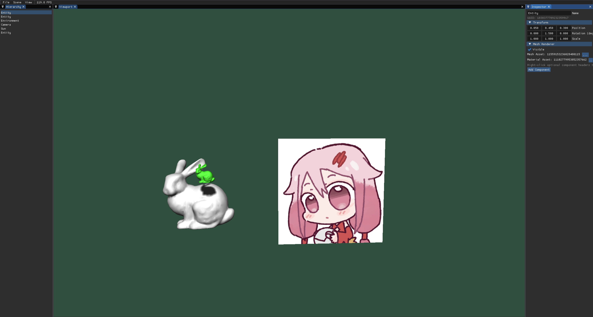

经过了 Artichoke 一个月左右的开发终于完成了 Vulcal Engine 的基础骨架，覆盖了 Engine Kernel 、Editor 。

其中 Kernel 实现了
- 基于 OpenGL 4.6 的 Vulchovy 实时渲染器，目前支持渲染 sprite、基于blinn-phong material model 的 mesh
- 抽象脚本结构，理论上可实现多语言脚本运行，目前只支持 Lua 。
- 基于 [Entt](https://github.com/skypjack/entt) 的 ECS 架构
- 支持 .obj、.png .jpg 等主流图片文件格式。

下面是 sandbox 场景，同时演示了 mesh、material、sprite 与 shadow 等功能：

Vulcal Engine v0.0.5 版本目前仅支持 Windows 与 Linux 系统，并且目前不支持打包完整游戏，游戏仅仅能在编辑器中运行，适合体验编辑器和探索引擎实现的开发者。

--- 

我们提供了两个由 AI 开发的游戏，贪吃蛇 和 最后三分钟。分别由 deepseek v4.1 flash 与 gpt 6.1 sol high 完成。

| 项目 | 贪吃蛇 | 最后三分钟 |
| --- | --- | --- |
| 截图 |  |  |
| 开发者 | DeepSeek V4.1 Flash | GPT 6.1 Sol High |
| 类型 | 经典街机 · 网格移动 | 俯视角射击 · 生存 |
| 玩法 | 控制贪吃蛇在场地中移动，吃掉红色食物让身体变长，同时避免撞上边界和自己的身体。 | 在竞技场中坚持三分钟，用射击和冲刺躲避红色敌人，尽可能多地击倒敌人。 |
| 操作 | 方向键控制移动方向 | `WASD` 移动，方向键射击，`Space` 冲刺 |
| 展示的引擎特性 | Sprite 渲染、Lua 脚本、输入系统 | Sprite 渲染、粒子效果、HUD、Lua 脚本 |

两个 Demo 都完全使用 Lua 脚本编写，直接运行在 Vulcal Engine 编辑器中，可作为了解引擎脚本能力与工作流的参考。

