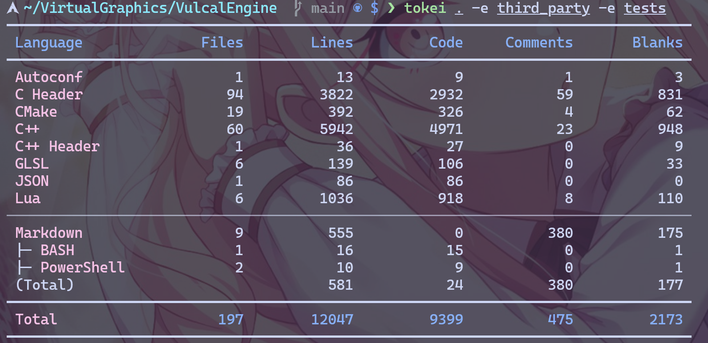

Vulcal Engine 开发以来也积累了一定的代码。

总的有效 C++ 代码量接近 8k 行。说不上多。但代码量也是存在的，其中大部分代码都是 AI 写的，从设计上来说虽然不是 slop ，但代码质量一定是 slop，我看着都难受。

所以我们打算每周都花一些时间去清理一下代码，就定在每周六吧！每周六如果我们写代码，那么就一定只做清理，这样项目看起来不烧心。

我们的目的就是让代码的格式，命名更优雅，目前我还没配置出适合我的 clang lint.

在这个过程中我们还能对代码进行多次的 review 从而找出一些设计问题，从而重构，定期的代码清理是很重要的。