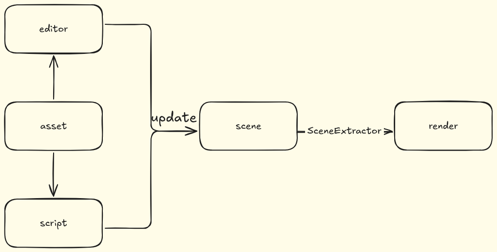

# Kernel
在这篇文章中我们将深入 Kernel 一步，从总体上了解 Kernel 中的各个模块的职责、作用、如何组织、如何进行数据交换的。

Kernel 是由 `render`、`script`、`asset`、`scene` 四个模块与基础核心组成。

## scene
> 在下面 `scene` 指 scene 模块，`Scene` 指 `scene` 模块下的 `Scene` 类

基于 ECS 的 scene 是引擎的中枢数据结构与调度中心，也是整体架构的骨架，是 Kernel 的核心模块。

`scene` 模块主要由 `Entity`、`Components` 和 `Scene` 三者构成：`Entity` 持有 `Components`，`Scene` 管理所有 `Entity` 的生命周期。ECS 中 System（'S'）的组织目前还比较分散，我们计划在 `v0.1.0` 给出更清晰的架构。

模块间的数据交换一般通过 scene 完成：

- `script`、`asset` 以及 Kernel 外部的 `editor` 负责设置 Scene 的状态、数据与逻辑行为；
- `render` 从 Scene 中提取渲染所需的数据。

从读写权限看，大多数情况下：

| 模块 | 对 Scene 的访问 |
|------|----------------|
| `asset` | 只写 |
| `render` | 只读 |
| `script` | 可读可写 |
| `editor` | 可读可写 |

Kernel 每帧通常遵循如下流程：
```
更新/修改 Scene → Rendering
```

在 `editor` 等外部程序中，我们通常通过 Scene 创建和修改 `Entity`；大多数情况下，是通过 `Components` 为某个 `Entity` 赋予属性与数据。例如在 `editor` 中为某个 `Entity` 添加 `LightComponent`，再修改其字段数据。

Scene 修改完成后，由 `SceneExtractor` 从中提取 `render` 所需的数据。

## render
`render` 模块提供给 Vulcal Engine 渲染能力。游戏画面，editor 中的 panels，model_viewer 都是使用 render 进行渲染。

在 kernel 中 `render` 的主要职责就是负责将 `scene` 中的渲染数据进行渲染，由定义在 `scene` 模块中的 `SceneExtractor` 提取出 `render` 中的 `Renderer` 能读懂的 `RenderData` 并由 `SceneExtractor` 将 `RenderData` 传递给 `Renderer` 进行渲染。渲染参数的配置是在 `scene` 中的 `components` 定义的。`render` 模块不应该修改 `scene` 中定义的数据（否则就会得到与用户不一致的数据）只能进行进一步的数据转换加工。

## asset
`asset` 模块分为两块，一个在 kernel 内部称作 `runtime asset` 另一个在 kernel 外部称作 `offline asset` ，`runtime asset` 模块定义了 kernel 内部统一的资源格式，以及对这些资源的写读操作，负责管理已经加载进内存的资源。

在 kernel 中除了 `asset` 模块本身，一般只有 `scene` 模块中的 `Components` 会通过句柄引用 `asset` 模块中保存的资源，通常我们不会在 `asset` 模块中修改 `scene` 中某个具体的 `Entity`，而是通过其他方式间接性的修改/配置 `scene` 中某个 `Entity` 的某个 `Component` 中的 `asset` 句柄。

例如我们可以在编辑器中修改/配置某个 componenet 的 asset handle 字段; 我们还可以在 lua 脚本中修改/配置某个 componenet 的 asset handle 字段；

## script
`script` 模块用于驱动游戏逻辑、控制对象行为。脚本文件也是一种 asset （目前不是）将会通过 `scene` 模块中的 `Components` 绑定到某一个特定的 `Entity` 上，用于执行一些特定的逻辑。目前只支持 Lua 脚本。不同 `Entity` 的 `script` 会在渲染前每帧更新，修改 `scene` 的数据。



## 单帧流程
目前 Vulcal Engine 仍是单线程结构，单帧流程非常简单。在 `vulcal_engine/engine/application.cpp` 中的 `run()` 函数中，我们可以看到如下结构。

```cpp
// 这里省略了很多代码
void Application::run() {
    while (running_ && !window_->should_close()) {
        window_->poll_events();

        for (auto& layer : layer_stack_) {
            layer->on_update(dt);
        }

        for (auto& layer : layer_stack_) {
            layer->on_render();
        }

        context_->swap_buffers();
    }
}
```

没错如果你熟悉 [Hazel Engine](https://github.com/TheCherno/Hazel) 的话可能对此结构非常熟悉，因为 Artichoke 也是师从 Cherno 所以采用了和 Hazel 一样的 Layer Stack 分层结构。与 Hazel 不同的是，我们将很多类的所有权交给应用层，而不是放在 Application 中，这样做的好处是我们可以更自由的使用 Kernel 创建其他应用，并且不带多余的模块。

我们以 `editor` 中的 `play` 模式进行讲解，在应用启动时，我们会创建 Layer 并将其 push 到 Layer Stack 中，在 push 时会自动对该 Layer 进行初始化 `attch`。

在 Editor Layer 中的 `attch` 阶段，我们首先会创建并初始化 `editor` 所需的模块，如 `renderer`,`scene_extractor` 等等。当编辑器进入 `play` 模式后会对 `script` 进行初始化，把需要被 `script` 更新的 `scene` 传递给 `script` 。好了整体上初始化工作已经完成了，处理完一些其他的杂七杂八的工作后随后我们就会进入主循环首先我们会调用我们定义好的钩子函数 `on_update()` 在 on_update 中首先会更新 `script` ，在 `on_update` 中将这帧 `scene` 更新好后就可以结束 `on_update` 了，随后我们会进入 `on_render()` 使用 `scene_extractor` 提取出 `RenderData` 提交给 renderer 进行渲染。