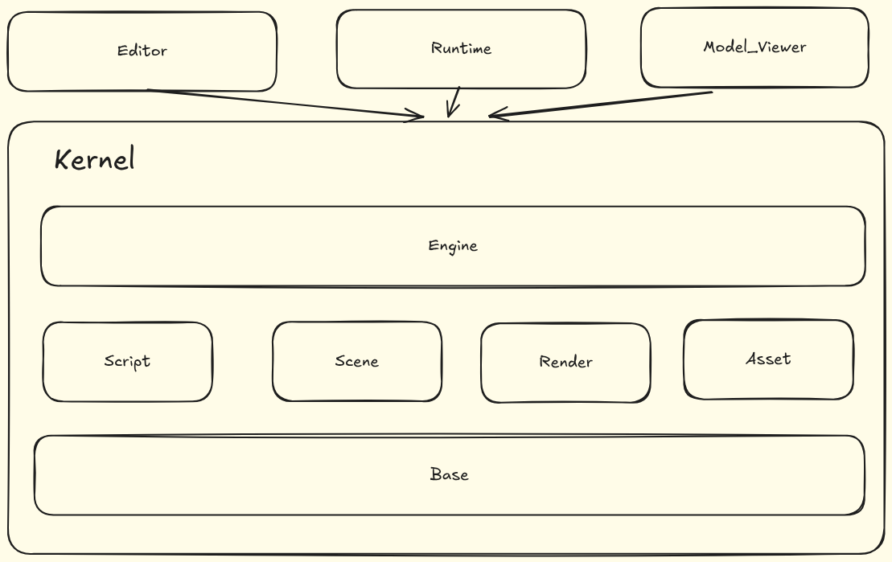

# 总体架构

> 阅读下述文档时假设你对游戏引擎架构有一点点的了解

Vulcal Engine 的主体称作 Kernel ，在 Vulcal Engine 的仓库根目录下名为 `vulcal_engine` 就是 Kernel，在我们的默认 cmake 配置下 Kernel 会被编译为静态库。

使用 Kernel 为基础开发的其他可运行应用称为 app 。在 Vulcal Engine 的仓库根目录下名为 apps 下的 `editor` 和 `model_viewer` 等都是 app。

具体的：
- `editor`: Vulcal Engine 默认引擎编辑器，用于可视化提供给游戏开发者开发游戏，编辑场景。
- `model_viewer`: Kernel 中核心渲染器 `Vulchovy` 的专属应用。提供给美术开发者预览在其他第三方建模软件的模型在 Vulcal Engine 下的渲染结果，并可调整一些简单的渲染参数。
- `asset_import`: 将外部的资源 如 `.obj`, `.gltf`（暂不支持）, `.png`, `.mp3`（暂不支持）等等文件离线（发现在游戏运行前）导入为 Kernel 能够识别的如 `.vmehs`, `.vmatc`, `.vtex` 等文件。
- `runtime`: 将在 v0.1.0 支持。 ~~游戏运行时，玩家通过该可执行二进制程序运行游戏，默认会从相同路径找打包好的 `.vpak` 文件，并由 pak reader 运行时加载~~

## Kernal 中的模块
Kernal 由`render`, `script`, `asset`, `scene` 模块与 基础核心 组成。

### 基础核心
`base` 和 `engine` 组成了基础核心。

`base` 提供了 Kernel 需要使用的基础平台工具以及基础类。如抽象 `Window` 封装了 `SDL_Window` 提供各个操作系统的窗口管理；以及一些文件 `io`，设备 `io` 等等。

`engine` 则管理了整个应用的生命周期。

### render
render 模块则提供给 Kernel 进行实时渲染的能力，其中的渲染器名为 `Vulchovy`，`Vulchovy` 渲染器目前仅支持 OpenGL 4.6 图形 API，未来明确支持 vulkan 。考虑到除游戏运行时 `runtime` 需要使用到渲染能力以外，引擎工具链 apps 也需要使用到渲染能力，最直接的就是用于渲染 ImGUI 所以外部 app 也需要使用 `Vulchovy` 的渲染能力。

### scene
scene 模块是引擎中最核心的模块，它基于 [Entt](https://github.com/skypjack/entt) 构建 ECS 架构。Artichoke 认为在 ECS 驱动的引擎中，由 ECS 构成的 Scene 是游戏引擎的中枢数据结构与调度中心，是引擎架构的骨架核心。几乎所有的模块都通过 Scene 结合在一起。后续你将能更直观的感受到。

### asset
asset 模块定义了运行时内部资源的格式，并且管理和读取这些文件。通过外部 asset_import 离线烘焙后的资源文件就是由它定义和管理的。引擎需要看懂外部世界千奇百怪的资源文件，然后用引擎内部统一的方式处理。

### script
script 模块用于驱动游戏逻辑、控制对象行为。脚本文件也是一种 asset （目前不是）将会被绑定到某一个特定的 ECS entity 上，用于执行一些特定的逻辑。目前只支持 Lua 脚本。

