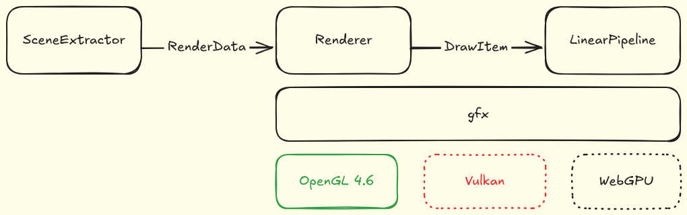

# Render

Render 是 Kernel 中最重要的模块之一。在 Vulcal Engine 中 `render` 模块 由其核心 renderer 以及其他为 renderer 提供能力的小模块组成。

可以把 renderer 看作是一个工厂，输入给他一些原材料 `RenderData` 输出结果为一张图 `RenderTarget` 或者直接将结果输出到 swapchain 中。renderer 通常不会进行真正的渲染，目前 renderer 会持有一个线性 pipeline ,我们会在 renderer 中进一步对数据进行一次处理然后将最终得到的 `DrawItem` 交给 Pipeline 进行处理，通过合理的配置 pipeline 的 pass 节点可以控制 renderer 的渲染结果。有关具体的 [渲染数据流](#renderresource) 我们在后面介绍

在未来我们会实现 frame graph，我们可以在程序中内置多个 graph，可用于切换渲染管线。（虽然现在也能做到）

目前 renderer 只支持 opengl 4.6，并封装在名为 gfx 中，在未来支持 vulkan 后，gfx 会变成 renderer 的 RHI。

目前 renderer 的 shader 不支持配置，使用 blinn phong shading model ，并且目前的 shadow map 的 view 不支持随 camera 的 frustum 进行调整，这会导致只有 世界坐标中心的地方才有 shadow ，所以目前 vulcal engine 不适合制作大世界 3d 游戏。

## RenderResource
在这一节我们将搞清楚我们如何从将外部的 `.png` 纹理渲染到一张 sprite 上，其他的数据流类似。

假设我们正在进行这样一项操作，在编辑器中为某个 entity 添加了一个 `SpriteRendererComponent` 然后选取了某张 `.png` 文件。

首先对个资源处理的是 `asset` 模块，将外部资源转换为引擎内部能看懂的定义在 cpu 上的二进制数据 `.vtex` (/vulcal_engine/asset/res/texture_asset.cpp)，并由 asset manager 管理缓存，并将指向该缓存的 AssetHandle 交给 `SpriteRendererComponent` 待后续使用的时候进行查询。

## 待更新