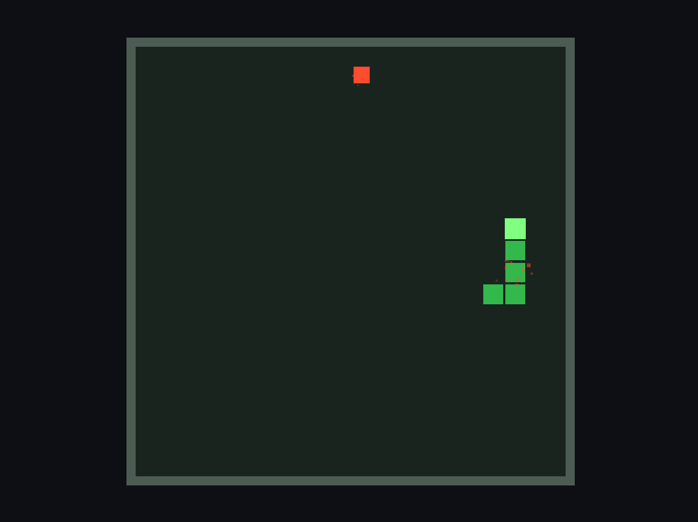
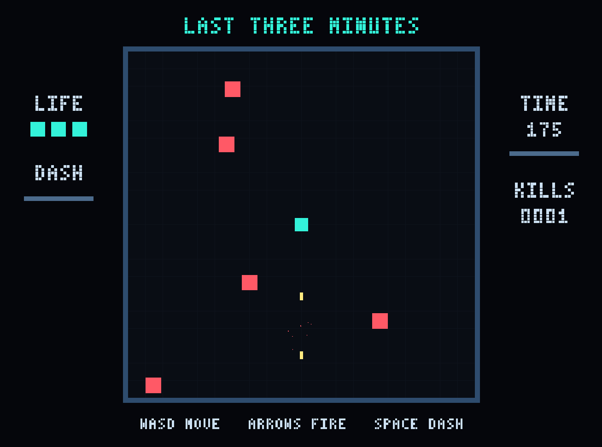

# 示例项目

完成[源码构建](./building.mdx)后，启动 `vulcal_editor`。通过编辑器打开引擎源码仓库中的对应项目，然后点击 **Play**。

## 贪吃蛇

打开 `projects/snake/snake.vproj`。游戏自动开始，使用 **WASD** 移动，按**空格**重新开始。

## 最后三分钟

打开 `projects/arena/arena.vproj`。按 **Enter** 开始，使用 **WASD** 移动、**方向键**射击、**空格**冲刺。详细玩法、实现和测试命令见引擎仓库的 [Arena README](https://github.com/Virtual-Graphics/VulcalEngine/blob/main/projects/arena/README.md)。
