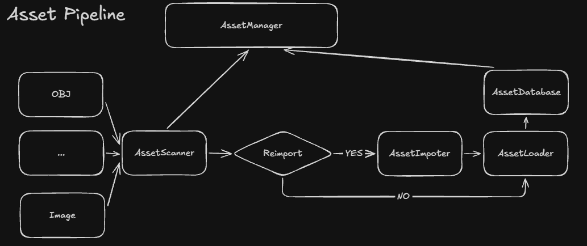

> 需要注意的是这里接受的是 Vulcal Engine 内部的 Asset Pipeline v1 的架构设计，并且这是 Artichoke 完全自创的，所以它相比与其他专业的游戏引擎的架构完全就是依托。
## Abstract
在游戏开发中我们通常会用到大量的美术资源，如模型、纹理、音效等等。通常我们需要将这些资源在进入游戏时加载到 RAM 中，所以你在进入游戏的时候通常需要等上那么一会，就是游戏的 Runtime 在加载被游戏引擎打包好的资源。通常在进入游戏的时候不会加载游戏中的所有资源，Runtime 只会加载此时需要的资源，否则 RAM 将很快被撑满。我们都知道很多游戏都是用游戏引擎开发的，那么资源处理问题就是引擎需要考虑的了，引擎需要管理资源的加载，卸载，更新等等。如何设计一个高效的，简单的，快速的 Asset Pipeline 是一个重要的问题。在这篇文章中记载了 Vulcal Engine 的 Asset Pipeline 设计构思，以及最终架构。

## Motivation
我给 Vulcal Engine 的定位是结构清晰、设计优雅、简单易用。所以我们不能设计出一个庞然大物、结构复杂、各种模块交织在一起的东西（至少现在不能，我不知道未来会演变成什么样）。所以 Asset 模块，后面都叫做 Asset Pipeline 。我不清楚其他游戏引擎的 Asset 模块叫什么，但我将 Vulcal Engine 的 Asset 模块称作 Asset Pipeline ，至于为什么这么叫，因为头脑里对外部资源的处理的样子就像将 其交给一条流水线管线一样经过处理变成 Engine 内部可用 Asset 形式。

## How does the Asset Pipeline v1 work in Vulcal Engine
Asset Pipeline 的工作是将外部 资源 如模型文件（obj,GLTF,FBX 等）、图像文件（png,jpg,dds 等）、音频文件（mp3,wav,flac 等）通过处理变成引擎内部可识别资产，这样做的原因是游戏引擎独立的维护着自己对资源的解释方式，如 Mesh 的顶点布局等引擎需要以自己的方式看懂这些外部资源，另一方面引擎希望统一同一类型的资源，而统一的方式就是使用引擎自己的定义对资源解释方式。

### Asset Scanner
通常引擎编辑器都会有自己的工作区/工作目录，我们通常打开一个游戏引擎的编辑器开始开发一款新游戏的时候需要创建一个项目/工作区，而工作区实际上是操作系统的文件系统之上的一层抽象，维护了一个引擎内部的文件系统。通常我们会将所有的资源放到工作目录下，而后 Asset Pipeline 中的会以某种方式（递归或者其他方法）扫描工作目录下的所有文件，寻找到能被引擎内部解析的资源（通常是索引文件的后缀名），在 Vulcal Engine 中负责扫描资源的模块称作 Asset Scanner ，比如我们的 Asset Pipeline 只支持 obj 资源，那么 Asset Scanner 就会寻找 .obj 后缀文件，并判断是否需要导入或重新导入。  

### Asset Importer
在 Vulcal Engine 中处理导入和重新导入的模块叫做 Asset Importer ，一个没有被导入过的 Asset 经过 Asset Importer 导入后会生成一个唯一对应的 .meta 文件，这个 .meta 文件记录了 Asset Handle / Asset ID 而 Asset Handle 是一个资源的 “身份证”，在引擎内部我们通常只用 Asset Handle 索引一个 Asset ，除此之外 .meta 文件还会保存一些导入设置信息，导入设置信息决定了 Asset Importer 怎么导入该 Asset ，比如一个 Texture 的导入设置：Texture Type、Wrap Mode、Filter Mode 等。当 .meta 信息与对应的资源文件被修改就会触发重导入，而判断信息是否修改的方法中最朴素的就是根据修改时间判断，另一个方法是判断文件 Hash ，当然除此之外还有其他的方法。所以总的说 Asset Importer 在 Vulcal Engine 中其到的作用就是给没导入过的外部资源生成 .meta 文件，并且判断是否需要重新导入。

### Asset Loader
在 Asset Importer 后，如果一个资源需要导入或者重新导入，则该资源会进入 Asset Loader 被加载到引擎内部能被识别的形式，我们熟悉的 [tinyobjloader](https://github.com/tinyobjloader/tinyobjloader)、[stb](https://github.com/nothings/stb) 等等都是在这个阶段运行的。而被加载到内存的资源会被存放在 Asset database 通过 Asset Handle 进行索引。

需要注意的是 Vulcal Engine Asset Pipeline v1 不支持 cooked asset ，所以在 Editor / Build 阶段发生的过程和 Runtime / Gaming 时完全一样。我们不希望 Runtime 直接通过 Asset Pipeline 加载，因为 Asset Pipeline 是开发游戏期间 (Editor / Build) 需要的功能，而在 Runtime 期间完全用不上，所以给 Runtime 使用 Asset Pipeline 完全多余。如果一个 Asset Pipeline 需要做的大致可用应该分离 Build 和 Runtime 的生命周期阶段。  

- 在 Build 阶段 外部资源 通过 Scanner + Importer → 产出 .meta 和导入后的中间产物 (cooked asset) -> Loader 把 cooked asset 加载进 RAM  
- 在 Runtime 阶段 Loader 把 cooked asset 加载进 RAM    

如果更近一步需要一个打包系统，在打包游戏的时候将 cooked asset 打包到一个 .pak 文件中 runtime 直接加载这个 .pak 文件

另一个需要考虑的是我们未来也会提供使用 Engine Core Libaray 使用 Native C++ 开发游戏的方式，但这种方式就完全不能让在编写 C++ 代码的时候再去使用 Asset Pipeline 去处理外部 Asset 文件，这会让开发者感觉到割裂这种方式在我看来完全不优雅，留到明天吧。